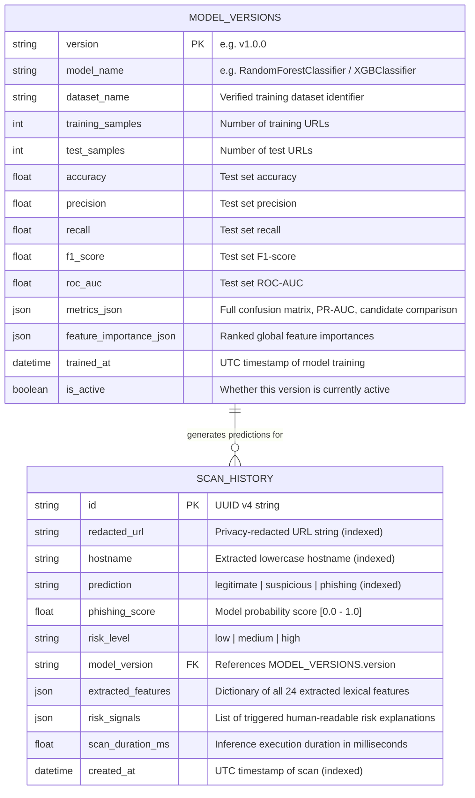

# Database Design Specification — PhishGuard AI

**Project Name:** PhishGuard AI  
**Database Engine:** PostgreSQL (SQLAlchemy 2.0 ORM + Alembic Migrations)  
**Document Version:** 1.0.0  
**Status:** Phase 1 – Approved  

---

## 1. Design Principles

1. **Privacy by Default (Query Parameter Redaction):** Raw URLs submitted by users often contain sensitive query values (e.g., password reset tokens, OAuth state parameters, session IDs, or email addresses). The database **never** stores unredacted query parameter values. Before persistence, all query parameter values are replaced with `[REDACTED]` (e.g., `https://login.example.com/auth?token=[REDACTED]&redirect=[REDACTED]`), while structural counts (`query_length`, `query_param_count`) are computed in volatile memory prior to redaction.
2. **Auditability & Model Traceability:** Every scan record is linked to the exact `model_version` string that produced the prediction, allowing historical tracking across model upgrades.
3. **Rich JSON Feature Storage:** Extracted lexical features and triggered risk explanations are persisted in structured JSON (`JSONB` on PostgreSQL / `JSON` via SQLAlchemy) so any historical scan can be inspected in full detail without re-running inference.
4. **Indexed Query Performance:** Columns used for dashboard aggregation, history search, classification filtering, and date range filtering are explicitly indexed.

---

## 2. Entity-Relationship Diagram



---

## 3. Table Specifications

### 3.1 `scan_history` Table

Stores every URL scan performed through the API, using privacy-redacted URL strings.

| Column Name | SQLAlchemy Type | Nullable | Default | Description |
| :--- | :--- | :--- | :--- | :--- |
| `id` | `String(36)` (UUID) | `False` | `uuid4()` | Primary key identifier for the scan record. |
| `redacted_url` | `String(2048)` | `False` | — | URL with all query parameter values masked as `[REDACTED]`. |
| `hostname` | `String(255)` | `False` | — | Extracted hostname from the URL for quick domain display and search. |
| `prediction` | `String(32)` | `False` | — | Classification verdict: `legitimate`, `suspicious`, or `phishing`. |
| `phishing_score` | `Float` | `False` | — | Raw model probability estimate for the phishing class ($0.0 \le p \le 1.0$). |
| `risk_level` | `String(32)` | `False` | — | Mapped risk severity: `low`, `medium`, or `high`. |
| `model_version` | `String(64)` | `False` | — | Version identifier of the ML model that evaluated the URL (e.g., `v1.0.0`). |
| `extracted_features` | `JSON` | `False` | `{}` | Key-value dictionary of the 24 extracted lexical and structural URL features. |
| `risk_signals` | `JSON` | `False` | `[]` | Array of structured signal objects (`id`, `title`, `severity`, `description`, `value`). |
| `scan_duration_ms` | `Float` | `False` | `0.0` | Processing time in milliseconds for feature extraction + inference. |
| `created_at` | `DateTime(timezone=True)` | `False` | `func.now()` | UTC timestamp when the scan occurred. |

#### Indexes on `scan_history`
- `ix_scan_history_created_at` on `(created_at DESC)` — Optimizes paginated history queries and time-series dashboard aggregations.
- `ix_scan_history_prediction` on `(prediction)` — Optimizes filtering by verdict (`phishing`, `suspicious`, `legitimate`) and classification distribution counts.
- `ix_scan_history_hostname` on `(hostname)` — Optimizes substring/domain searches.

---

### 3.2 `model_versions` Table

Stores metadata and evaluation metrics for registered machine learning model versions. Synchronized automatically on backend startup from the active versioned artifact metadata file (`backend/app/ml/artifacts/<version>/metadata.json`).

| Column Name | SQLAlchemy Type | Nullable | Default | Description |
| :--- | :--- | :--- | :--- | :--- |
| `version` | `String(64)` | `False` | — | Primary key model version tag (e.g., `v1.0.0`). |
| `model_name` | `String(128)` | `False` | — | Algorithm name (e.g., `RandomForestClassifier`, `XGBClassifier`). |
| `dataset_name` | `String(255)` | `False` | — | Name/source of the verified dataset used for training. |
| `training_samples` | `Integer` | `False` | — | Count of URLs in the training split. |
| `test_samples` | `Integer` | `False` | — | Count of URLs in the held-out test split. |
| `accuracy` | `Float` | `False` | — | Held-out test accuracy. |
| `precision` | `Float` | `False` | — | Held-out test precision (phishing class). |
| `recall` | `Float` | `False` | — | Held-out test recall (phishing class). |
| `f1_score` | `Float` | `False` | — | Held-out test F1-score (phishing class). |
| `roc_auc` | `Float` | `False` | — | Held-out test Area Under the ROC Curve. |
| `metrics_json` | `JSON` | `False` | `{}` | Complete evaluation payload (Confusion Matrix, PR-AUC, domain-split metrics, candidate model benchmarks). |
| `feature_importance_json` | `JSON` | `False` | `[]` | Ordered list of `{feature, importance, description}` objects. |
| `trained_at` | `DateTime(timezone=True)` | `False` | — | UTC timestamp when the model artifact was trained. |
| `is_active` | `Boolean` | `False` | `True` | Indicates the currently active serving model. |

---

## 4. URL Redaction Specification

When a user submits a URL such as:
```text
https://secure-login.example-auth.com/verify/account?user=alice@company.com&session_token=98f7a6d5c4&continue=true
```
1. **In-Memory Feature Extraction:** The feature extractor runs on the full validated string in memory (`url_length=112`, `query_length=65`, `query_param_count=3`, `at_symbol_present=1`, etc.).
2. **Redaction Transformation (`redact_url_for_storage`):**
   - Parses query parameters via `urllib.parse.parse_qsl(..., keep_blank_values=True)`.
   - Replaces every non-empty parameter value with `[REDACTED]`.
   - Strips URL fragments (`#...`) or replaces fragment content if present.
   - Produces:
     ```text
     https://secure-login.example-auth.com/verify/account?user=[REDACTED]&session_token=[REDACTED]&continue=[REDACTED]
     ```
3. **Database Persistence:** Only the redacted representation is written to `scan_history.redacted_url` and returned in historical logs.

---

## 5. Retention & Privacy Controls

- **Single Record Deletion:** `DELETE /api/v1/history/{scan_id}` permanently deletes the row from `scan_history`.
- **Full History Purge:** `DELETE /api/v1/history` deletes all rows in `scan_history` for privacy cleanup.
- **Database Migrations:** Managed via **Alembic** (`backend/alembic/`) so schema changes can be applied reproducibly in local development and Render PostgreSQL production environments (`alembic upgrade head`).
