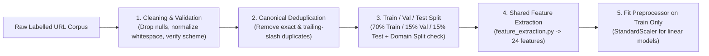

# Machine Learning Development Plan — PhishGuard AI

**Project Name:** PhishGuard AI  
**Document Version:** 1.0.0  
**Status:** Phase 1 – Approved  

---

## 1. ML Engineering Philosophy

The PhishGuard AI machine learning pipeline is designed around four core tenets:

1. **Real Raw-URL Supervision:** Because the production application accepts raw URLs from end users, the primary model must be trained and evaluated on a verified dataset of **raw URLs with reliable ground-truth labels**, not pre-computed feature tables (such as the UCI Phishing Websites dataset, which lacks raw URL strings and relies on external DOM/WHOIS features).
2. **Strict Training–Serving Parity:** A single deterministic Python module (`backend/app/services/feature_extraction.py`) transforms a raw URL string into a fixed-order numerical feature vector during both offline training and online FastAPI inference.
3. **Zero Data Leakage:** Duplicate URLs are removed prior to splitting, all scaling/imputation transformers are fit strictly on the training split, and both stratified random splits and **registrable-domain-grouped splits** are evaluated to measure generalization to unseen domains.
4. **Calibrated Security Decision-Making:** False negatives (classifying a phishing URL as legitimate) carry severe security consequences, while excessive false positives erode user trust. Models are evaluated across Precision, Recall, F1-Score, ROC-AUC, PR-AUC, and Confusion Matrix metrics rather than accuracy alone.

---

## 2. Dataset Research & Verification Protocol (Phase 2 Step 1)

During Phase 2, we will investigate and acquire an open, legally reusable, peer-reviewed or benchmark cybersecurity dataset containing raw phishing and legitimate URLs (for example, the *PhiUSIIL Phishing URL Dataset* from UCI / peer-reviewed literature, *LegitPhish*, *ISCX-URL*, or verified open raw-URL benchmark corpora available via open academic repositories/HuggingFace/GitHub with permissive licenses such as CC BY 4.0 / MIT).

Before training any model, the dataset must pass the following verification checklist and be documented in `docs/DATASET_CARD.md`:
- Verify source provenance, authorship, and license/usage terms.
- Confirm presence of raw URL strings (`http://` or `https://`) and binary class labels (`phishing` vs. `legitimate`).
- Inspect and record exact row counts, missing values, malformed URLs, exact duplicates, and class balance.
- Ensure no synthetic or invented URLs are presented as real benchmark data.

---

## 3. Data Preprocessing & Splitting Strategy

### 3.1 Anti-Leakage Controls
1. **Exact & Normalized URL Deduplication:** Strip leading/trailing whitespace and deduplicate identical URLs before splitting. If a URL appears with conflicting labels, drop both instances to prevent label noise.
2. **Stratified Train / Validation / Test Split:** Partition cleaned records into **70% Training**, **15% Validation** (for model selection and threshold calibration), and **15% Held-Out Test** (touched only once for final evaluation reporting).
3. **Domain-Aware Generalization Check:** In addition to the stratified split, evaluate how well the model generalizes when grouped by registrable domain (`GroupShuffleSplit` on domain) and document any performance difference transparently in `docs/MODEL_EVALUATION.md`.

---

## 4. Lexical & Structural Feature Specification

All 24 features are computed purely from the URL string without network calls:

| # | Feature Key | Type | Mathematical / Lexical Definition | Security Rationale |
| :- | :--- | :--- | :--- | :--- |
| 1 | `url_length` | `int` | Total character length of the full URL string | Phishing URLs frequently embed long redirect paths, encoded blobs, or deceptive subdirectories. |
| 2 | `hostname_length` | `int` | Character length of `parsed.hostname` | Attackers often register long combo-squatting hostnames (e.g., `secure-login-account-verify-portal.com`). |
| 3 | `domain_length` | `int` | Character length of the registrable primary domain | Distinguishes long base domains from deep subdomain chains. |
| 4 | `path_length` | `int` | Character length of `parsed.path` | Captures deep directory spoofing (`/auth/login/verify/session/...`). |
| 5 | `query_length` | `int` | Character length of `parsed.query` | Long query strings often carry tracking victim identifiers or base64-encoded emails. |
| 6 | `dot_count` | `int` | Count of `.` in the entire URL | High dot counts indicate deep subdomain nesting or file-extension obfuscation. |
| 7 | `hyphen_count` | `int` | Count of `-` in the entire URL | Hyphens are heavily used in typo-squatted domains and deceptive path slugs. |
| 8 | `hostname_hyphen_count` | `int` | Count of `-` specifically inside `parsed.hostname` | Legitimate top brands rarely use multiple hyphens in their primary hostname. |
| 9 | `underscore_count` | `int` | Count of `_` in the entire URL | Underscores in URLs and paths correlate with auto-generated phishing kits. |
| 10 | `slash_count` | `int` | Count of `/` in the URL path | Measures directory nesting depth. |
| 11 | `digit_count` | `int` | Count of numeric characters `[0-9]` in the URL | Phishing URLs often include random numeric sequences or IP addresses. |
| 12 | `hostname_digit_count` | `int` | Count of `[0-9]` inside `parsed.hostname` | Captures DGA-like or numbered lookalike domains (`apple-id247.com`). |
| 13 | `special_char_count` | `int` | Count of special symbols (`?`, `=`, `&`, `%`, `@`, `~`, `+`, `$`, `!`, `*`, `;`) | High special-character density indicates obfuscation or complex query injection. |
| 14 | `at_symbol_present` | `int` (0/1) | `1` if `@` appears in URL netloc/path, else `0` | Classic RFC credential prefix trick (`https://google.com@evil.com/login`). |
| 15 | `subdomain_count` | `int` | Number of subdomain labels preceding the registrable domain | Attackers place targeted brand names in subdomains (`paypal.com.verify.attacker.tld`). |
| 16 | `is_https` | `int` (0/1) | `1` if scheme is `https`, else `0` | Structural context feature. **Important:** Treated strictly in combination with other features; never assumed to mean safe. |
| 17 | `is_ip_address` | `int` (0/1) | `1` if `parsed.hostname` is a valid IPv4 or IPv6 literal, else `0` | Raw IP hosts bypass domain registration and are strongly associated with malicious hosting. |
| 18 | `has_punycode` | `int` (0/1) | `1` if `xn--` appears in `parsed.hostname`, else `0` | Detects IDN homograph attacks (e.g., Cyrillic `а` spoofing Latin `a`). |
| 19 | `suspicious_keyword_count` | `int` | Count of deceptive security/brand keywords (`login`, `verify`, `secure`, `account`, `update`, `signin`, `banking`, `confirm`, `password`, `wallet`, `recover`, `auth`, `credential`, `billing`, `unlock`, `suspend`) | Phishing URLs rely on urgency and authentication vocabulary in paths/subdomains. |
| 20 | `query_param_count` | `int` | Number of key-value parameters in `parsed.query` | Measures query parameter complexity. |
| 21 | `url_entropy` | `float` | Shannon entropy $H(X) = -\sum P(x_i)\log_2 P(x_i)$ of the URL characters | High character entropy captures random tokens, hashes, and obfuscated payloads. |
| 22 | `hostname_entropy` | `float` | Shannon entropy $H(X)$ of `parsed.hostname` | Identifies algorithmically generated or random-string hostnames. |
| 23 | `digit_to_length_ratio` | `float` | $\frac{\text{digit\_count}}{\max(\text{url\_length}, 1)}$ | Normalized measure of numeric density across short and long URLs. |
| 24 | `suspicious_hostname_pattern` | `int` (0/1) | `1` if hostname exhibits high-risk lexical patterns (e.g., embedded brand/TLD token in subdomain like `.com-` or `.net.`, >3 hyphens, or abused disposable TLD + keyword combination), else `0` | Captures composite hostname deception techniques. |

---

## 5. Candidate Models & Training Procedure

We will train, tune, and compare four distinct model families using fixed random seeds (`random_state=42`) for full reproducibility:

1. **Logistic Regression (`LogisticRegression`):**
   - Pipeline with `StandardScaler` (fit only on training split).
   - Serves as an interpretable linear baseline.
2. **Decision Tree (`DecisionTreeClassifier`):**
   - Tuned over `max_depth` and `min_samples_leaf` to prevent overfitting.
   - Non-linear single-tree baseline.
3. **Random Forest (`RandomForestClassifier`):**
   - Bagged ensemble of decision trees tuned over `n_estimators`, `max_depth`, and `min_samples_split`.
   - Strong resilience to noisy lexical features and non-linear feature interactions.
4. **XGBoost (`XGBClassifier`):**
   - Gradient-boosted decision trees tuned over `n_estimators`, `max_depth`, `learning_rate`, and `subsample`.
   - High discriminative capacity on tabular lexical features.

---

## 6. Model Selection & Evaluation Metrics

Each candidate model will be evaluated on the validation set and final held-out test set using:
- **Accuracy:** Overall proportion of correct classifications.
- **Precision (Phishing Class):** $\frac{TP}{TP + FP}$ — Proportion of flagged phishing URLs that are truly phishing.
- **Recall / Sensitivity (Phishing Class):** $\frac{TP}{TP + FN}$ — Proportion of actual phishing URLs successfully caught.
- **F1-Score:** Harmonic mean of Precision and Recall.
- **ROC-AUC:** Area under the Receiver Operating Characteristic curve.
- **PR-AUC:** Area under the Precision–Recall curve.
- **Confusion Matrix:** Explicit counts of $TN, FP, FN, TP$.

**Selection Criterion:** The production model will be chosen based on validation F1-score and Recall (prioritizing low false negatives while maintaining strong precision and calibration), as well as inference latency and stability across domain-aware splits.

---

## 7. Explainability Architecture

PhishGuard AI provides two complementary layers of explainability:

1. **Global Model Explainability (Model Insights Page):**
   - Exports normalized feature importances from the trained model into `metadata.json`.
   - Explains which lexical characteristics carry the greatest weight across the test corpus.
2. **Per-Scan Local Risk Signal Explanations (Scan Results Page):**
   - Evaluates the extracted features of the scanned URL against interpretable cybersecurity rules and feature contribution magnitudes to generate clear, human-readable **Risk Indicators** (e.g., *"IP Address Used as Hostname"*, *"Deceptive '@' Credential Prefix Detected"*, *"High Density of Authentication Keywords"*, *"Excessive Subdomain Nesting"*, *"High Hostname Entropy"*).
   - Explicitly notes that these indicators highlight structural properties observed in the URL rather than proving malicious intent with certainty.
