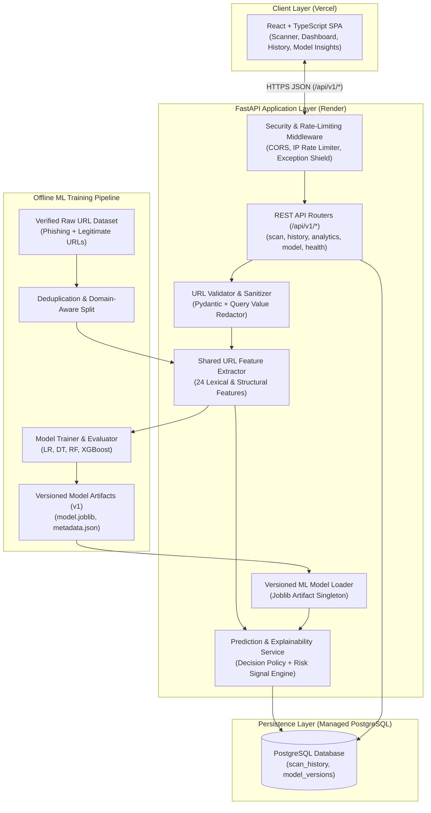
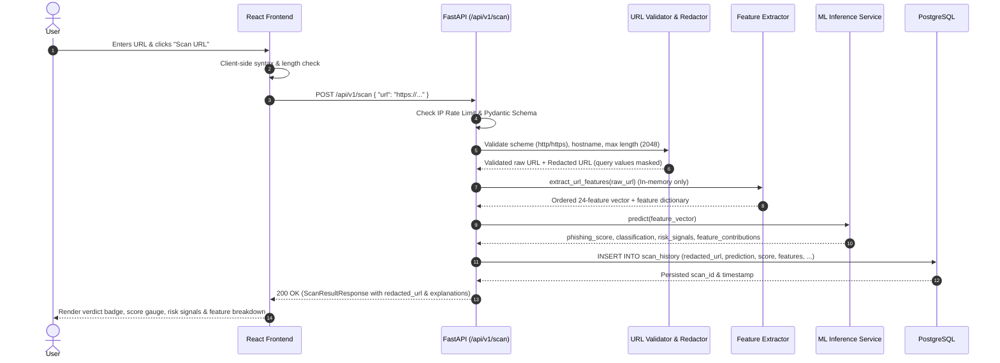

# System Architecture — PhishGuard AI

**Project Name:** PhishGuard AI  
**Document Version:** 1.0.0  
**Status:** Phase 1 – Approved  

---

## 1. Architectural Overview

PhishGuard AI uses a decoupled, three-tier client–server architecture engineered for security, low-latency ML inference, and strict training–serving consistency:

1. **Presentation Layer (Frontend):** A Single-Page Application (SPA) built with **React 18, TypeScript, Vite, Tailwind CSS, shadcn/ui patterns, Framer Motion, and Recharts**, deployed on **Vercel**.
2. **Application & ML Inference Layer (Backend):** A modular **Python FastAPI** service that validates requests, enforces rate limits, extracts URL lexical features in memory, runs predictions through a versioned **scikit-learn / XGBoost** artifact loaded at startup, computes human-readable risk signals, and sanitizes URLs before persistence. Deployed via Docker on **Render**.
3. **Persistence Layer (Database):** A relational **PostgreSQL** database accessed through **SQLAlchemy 2.0 ORM** and managed with **Alembic** migrations.

---

## 2. High-Level System Diagram

---

## 3. URL Scan Execution Sequence

Crucially, **no outbound network call is ever made to the submitted URL**. All analysis occurs passively on the URL string in memory:

---

## 4. Backend Component Architecture

The backend (`backend/app/`) is organized by responsibility:

- **`app/main.py`:** Application factory, lifespan management (loading ML artifacts and initializing database metadata on startup), CORS middleware, global exception handlers, and router mounting.
- **`app/core/config.py`:** Centralized `pydantic-settings` configuration reading `.env` variables (`DATABASE_URL`, `CORS_ORIGINS`, `MODEL_VERSION`, `RATE_LIMIT_PER_MINUTE`, `ENVIRONMENT`).
- **`app/core/security.py`:** In-memory sliding-window IP rate limiter, request validation helpers, and security headers middleware.
- **`app/utils/url_sanitizer.py`:**
  - Validates URL structure, scheme (`http` or `https`), and hostname presence.
  - Redacts query string parameter values (`?session=abc123&email=user@test.com` $\rightarrow$ `?session=[REDACTED]&email=[REDACTED]`) before database storage or logging.
- **`app/services/feature_extraction.py`:**
  - Pure, deterministic Python module that computes all 24 lexical and structural features from a URL string using only standard library parsing (`urllib.parse`, `re`, `math`, `ipaddress`).
  - Zero external network dependencies.
  - Imported directly by both the offline training pipeline (`app/ml/train.py`) and the online inference service (`app/services/prediction_service.py`), guaranteeing **zero training–serving skew**.
- **`app/ml/model_loader.py`:**
  - Thread-safe singleton loader that reads the active model bundle (`model.joblib`, `scaler.joblib` if applicable, `feature_schema.json`, `evaluation_metrics.json`) from `app/ml/artifacts/<version>/`.
- **`app/services/prediction_service.py`:**
  - Orchestrates feature extraction, model probability inference, 3-tier decision thresholding (`legitimate`, `suspicious`, `phishing`), and human-readable risk signal generation.
- **`app/database/`:**
  - `connection.py`: SQLAlchemy engine and session generator (`get_db`). Supports PostgreSQL in production/local server mode and SQLite fallback for isolated test runs.
  - `models.py`: SQLAlchemy ORM models (`ScanHistory`, `ModelVersion`).
  - `schemas.py`: Pydantic v2 request and response models with strict validation and OpenAPI examples.
- **`app/api/routes/`:**
  - `scan.py`: `POST /api/v1/scan`
  - `history.py`: `GET /api/v1/history`, `GET /api/v1/history/{scan_id}`, `DELETE /api/v1/history/{scan_id}`, `DELETE /api/v1/history`
  - `analytics.py`: `GET /api/v1/analytics/overview`
  - `model.py`: `GET /api/v1/model/info`
  - `health.py` (or in `main.py`): `GET /api/v1/health`

---

## 5. Frontend Component Architecture

The frontend (`frontend/src/`) follows a modular, feature-oriented structure:

- **`src/layouts/MainLayout.tsx`:** Responsive shell containing the sticky top navigation bar, brand identity, active route indicators, theme toggle (Dark/Light), mobile drawer, and footer.
- **`src/pages/`:**
  - `LandingPage.tsx`: Hero section with embedded live URL Scanner, "How PhishGuard AI Works" pipeline visual, key features grid, ML methodology overview, real model performance preview fetched from `/api/v1/model/info`, security & privacy guarantees, and CTA.
  - `ScannerPage.tsx`: Dedicated scanning workspace with URL input, instant format validation, safe clickable example presets, animated scanning indicator, and full inline Scan Results display.
  - `ScanResultDetailPage.tsx` / `ScanResultPanel.tsx`: Displays classification badge (Green/Amber/Red), model risk score meter, mandatory safety disclaimer, triggered risk indicators, and complete 24-feature breakdown table.
  - `DashboardPage.tsx`: Real-time cybersecurity analytics dashboard with KPI cards, classification distribution donut chart, scan volume timeline chart, recent scans table, and empty-state handling.
  - `HistoryPage.tsx`: Searchable, filterable, paginated table of historical scans with modal/drawer detail inspector, single-item deletion, and full history purge.
  - `ModelInsightsPage.tsx`: Deep dive into the trained model version, dataset summary, confusion matrix heatmap/grid, candidate model comparison table, and global feature importance bar chart.
  - `AboutPage.tsx`: Architectural transparency, privacy policy (query redaction), passive analysis guarantees, and limitations of lexical ML detection.
- **`src/services/api.ts`:** Typed HTTP client communicating with `VITE_API_BASE_URL` with structured error parsing.

---

## 6. Security & Privacy Boundaries

1. **No SSRF Surface:** Because PhishGuard AI never fetches or resolves submitted URLs, attackers cannot abuse the scanner to probe internal cloud metadata (`169.254.169.254`), localhost ports, or intranet services.
2. **Query Parameter Privacy:** Sensitive tokens in URLs are never written to PostgreSQL. Feature extraction counts query length and parameter count in volatile memory, and immediately discards raw query values before persisting `redacted_url`.
3. **XSS Prevention:** Submitted URLs are never rendered as clickable `href` links that execute `javascript:` or `data:` payloads; only `http://` and `https://` schemes are accepted, and displayed URLs are rendered as non-executable monospace text.
